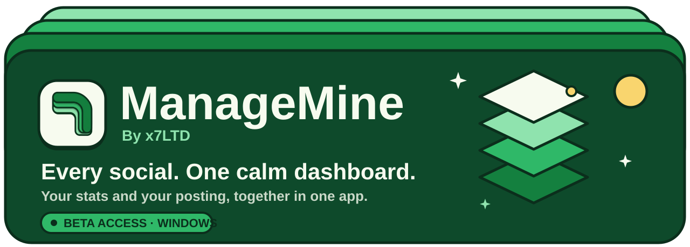
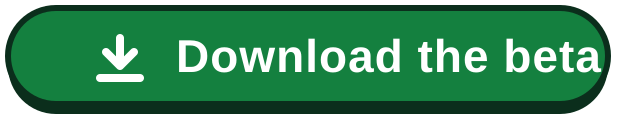
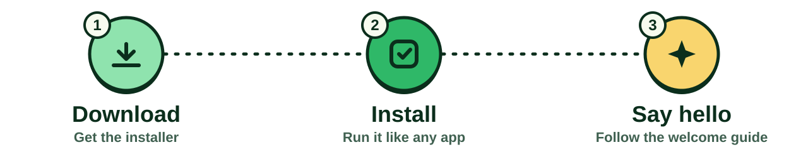

  

  

  <b>Beta access</b> &nbsp;·&nbsp; Windows &nbsp;·&nbsp; Version 1.2.0 &nbsp;·&nbsp; Free

  

## Hello, creator 👋

Posting everywhere and checking every app, over and over, takes more time than making the content.

**ManageMine puts it all in one place on your computer.** See how your videos are doing, and publish one video to all your platforms with a single click.

No sign-up. No subscription. Just install it and go.

 

## What you can do

  

**See it all.** Your views, likes, comments and followers from LinkedIn, YouTube, Instagram and TikTok, side by side. If ManageMine can't read a number, it tells you, so you are never looking at old numbers without knowing.

**Post once.** Add your video, title and description one time. ManageMine fills them in on every platform for you, and shows a live character count for each one, so you know your post fits before you send it.

**Try it safely.** Test Mode is switched on by default. ManageMine does everything except press the final Publish button, so you can see exactly what would happen. Nothing goes live until you say so.

 

## Get started in 3 steps

  

1. **Download.** Click **Download the beta** at the top of this page, or open `ManageMine-Setup-1.2.0.exe` above and press the download button.
2. **Install.** Open the file you downloaded and follow the screens, like any other app.
3. **Say hello.** ManageMine opens with a short welcome guide. It helps you connect your first account and try a safe test post.

> [!NOTE]
> **Windows may show a blue box that says "Windows protected your PC".**
> ManageMine is a new, independent app, and Windows shows this for apps it hasn't seen many times yet. If you downloaded it from this page, click **More info**, then **Run anyway**.

 

## Works with

  

|  | See your stats | Post your videos |
|---|:---:|:---:|
| LinkedIn | ✅ | ✅ |
| YouTube | ✅ | ✅ |
| Instagram | ✅ | ✅ |
| TikTok | ✅ | ✅ |
| X | – | ✅ |

 

## Good to know

This is a **beta**, which means it works, but it is still growing.

- **Rough edges are normal.** If something looks odd, it's probably a bug and we'd love to hear about it.
- **Platforms change their pages.** ManageMine works the way you do, through your browser, so when a platform redesigns something, one feature may stop working until we update it.
- **You need Chrome, Edge, Brave, Opera or Vivaldi.** ManageMine uses the one you already use every day. If your main browser is Firefox, it will use Chrome or Edge instead, so you need one of those installed.
- **Windows.** Made for Windows. Tested on Windows 11.

 

## Your privacy

- ManageMine has **no accounts and no servers of its own**.
- **You sign in to each platform yourself.** ManageMine never sees or stores your passwords.
- Your numbers, your sign-ins and your upload history **stay on your computer**.

 

## Questions, bugs and ideas

Found something broken, or have an idea that would make your day easier? Open the **Issues** tab at the top of this page and tell us. Real creators shape what comes next.

 

---

  <b>ManageMine</b> &nbsp;·&nbsp; Made by <b>x7LTD</b> 
  Free to use under the MIT License. See the <a href="LICENSE">LICENSE</a> file. 
  ManageMine is independent. It is not made by, or endorsed by, X, LinkedIn, YouTube, Instagram or TikTok.

